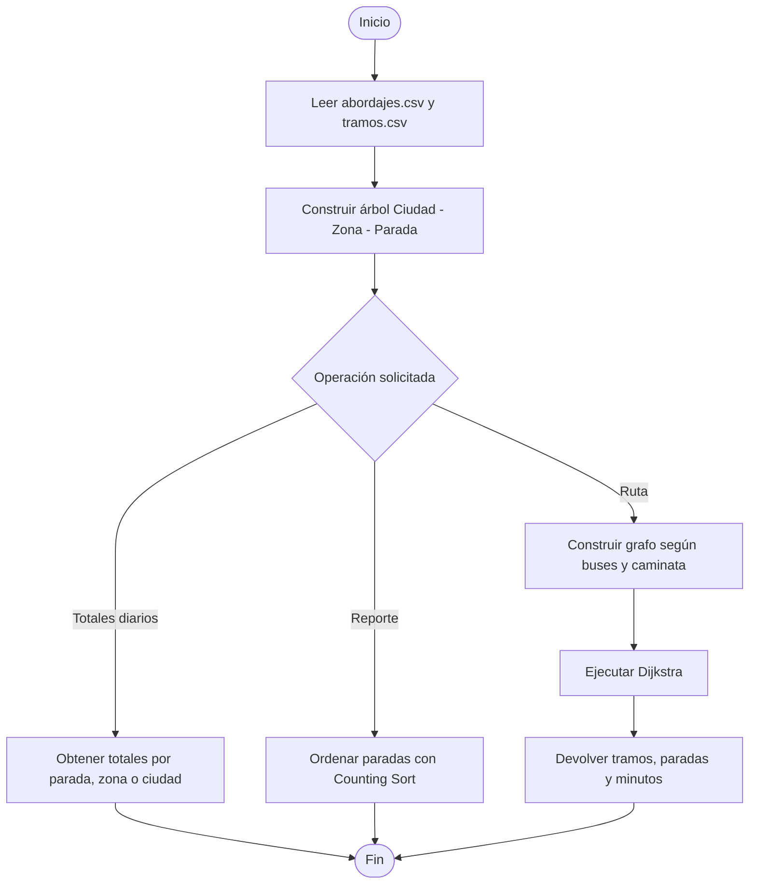
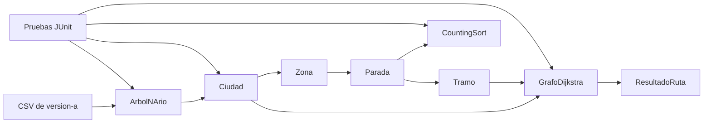
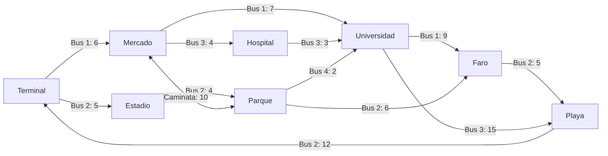

# Examen 2 - RutaBus, planificador de viajes urbano

## Nombre del examen-proyecto

**Examen 2 - RutaBus, planificador de viajes urbano**

## Nombre de los autores

- Pendiente de completar con los nombres de los integrantes.

## Requerimientos del sistema

La lista formal de requerimientos funcionales y no funcionales aprobada por los estudiantes en la Parte 1 no se encuentra en este repositorio. Debe incorporarse aquí literalmente desde la hoja entregada, sin modificarla.

El enunciado de la Versión A incluye las siguientes features:

**F1. Directorio de paradas.** Cada parada pertenece a una zona y cada zona a la ciudad. La oficina debe poder agregar una parada a una zona, listar las paradas de una zona y obtener el total de abordajes diarios de cualquier zona o de toda la ciudad.

**F2. Reporte de pasajeros.** Cada noche, lista las 1,200 paradas de más a menos abordajes; en caso de empate, por código de parada de la A a la Z. El reporte corre en un servidor compartido, así que su tiempo de ejecución debe estar garantizado incluso con la peor entrada posible, no solo en promedio.

**F3. Planificador de viajes.** Un pasajero elige una parada de salida y un destino. La app le dice qué buses tomar (y si debe caminar un tramo corto) para llegar lo antes posible, y cuántos minutos tardará. Los buses solo circulan en el sentido de su línea; caminando se puede ir en ambos sentidos.

## Instrucciones de instalación y ejecución

### Requisitos previos

- JDK 17 o superior.
- Maven.

### Compilar y ejecutar

Desde la raíz del repositorio:

```powershell
cd java
mvn compile
java -cp target/classes cr.ac.tec.examen2.Main
```

`Main` es el punto de entrada incluido. Las operaciones de la solución también pueden usarse desde sus clases: `ArbolNArio.construirArbolNario(...)` carga el árbol desde los CSV, `CountingSort.ordenarParadas(...)` ordena las paradas, y `GrafoDijkstra.dijkstra(...)` calcula una ruta que combina buses y caminata. Para una ruta solo de bus o solo de caminata se usan `dijkstraBuses(...)` y `dijkstraCaminata(...)`.

Ejemplo de uso desde `java/` con JShell:

```powershell
jshell --class-path target/classes
```

```java
import cr.ac.tec.examen2.*;
var ciudad = ArbolNArio.construirArbolNario("../datos/version-a/abordajes.csv", "../datos/version-a/tramos.csv");
var ruta = GrafoDijkstra.dijkstra(ciudad, "Terminal", "Universidad");
System.out.println(ruta.getDescripcion());
```

### Ejecutar las pruebas

Desde `java/`:

```powershell
mvn test
```

En IntelliJ IDEA, ejecutar las clases de prueba como pruebas JUnit y establecer el directorio de trabajo en `$PROJECT_DIR$/java`, para que las rutas relativas de los archivos CSV se resuelvan correctamente.

## Jerarquía de carpetas y módulos

```text
.
├── datos/
│   ├── version-a/                 # CSV de RutaBus: abordajes y tramos
│   └── version-b/                 # CSV de la versión SalidaSegura
├── java/
│   ├── pom.xml                    # Configuración Maven y JUnit
│   └── src/
│       ├── main/java/cr/ac/tec/examen2/
│       │   ├── Algoritmos.java    # Punto de entrada auxiliar
│       │   ├── Main.java          # Punto de entrada del proyecto base
│       │   ├── ArbolNArio.java    # Carga el árbol n-ario desde los CSV
│       │   ├── Ubicacion.java    # Clase abstracta base del árbol
│       │   ├── Ciudad.java       # Ciudad y zonas hijas
│       │   ├── Zona.java         # Zona y paradas hijas
│       │   ├── Parada.java       # Parada, abordajes y tramos asociados
│       │   ├── Tramo.java        # Línea, origen, destino y duración
│       │   ├── CountingSort.java # Ordenamiento de paradas por abordajes y código
│       │   └── GrafoDijkstra.java # Grafos de transporte y algoritmos de ruta
│       └── test/java/cr/ac/tec/examen2/
│           ├── SmokeTest.java
│           ├── ArbolNArioTest.java
│           ├── CountingSortTest.java
│           └── GrafoDijkstraTest.java
├── scripts/
│   └── verificar-restricciones.sh # Búsqueda informativa de APIs restringidas
├── PROMPTS.md                     # Registro textual de prompts usados
└── README.md
```

### Módulos y clases

- `Ubicacion`, `Ciudad`, `Zona` y `Parada` forman el árbol de ubicaciones. Ciudad contiene zonas; cada zona contiene paradas. El total de abordajes se obtiene por parada, zona y ciudad.
- `ArbolNArio` lee `abordajes.csv` y `tramos.csv` y construye las ubicaciones con sus tramos.
- `Tramo` representa una conexión con su línea, origen, destino y tiempo en minutos.
- `CountingSort` ordena las paradas por abordajes descendentes y, en caso de empate, por código ascendente.
- `GrafoDijkstra` calcula rutas de bus dirigido, caminata bidireccional o combinaciones, y devuelve las paradas y tramos de la ruta junto con su duración.
- Las clases `*Test` contienen las pruebas de los algoritmos y estructuras.

## Requerimientos desarrollados por los estudiantes

La hoja de requerimientos de la Parte 1 no está incluida, por lo que no es posible verificar o reproducir los identificadores RF/RNF presentados por los estudiantes. La siguiente correspondencia se refiere únicamente a las features F1-F3 del enunciado de la Versión A.

| Feature | Estado en esta implementación |
|---|---|
| F1. Directorio de paradas | Implementada en las clases del árbol: se agregan zonas y paradas, se pueden listar y se calculan los abordajes diarios por parada, zona y ciudad. |
| F2. Reporte de pasajeros | Parcialmente implementada: `CountingSort` ordena el arreglo de entrada según los dos criterios. No selecciona ni genera por sí mismo el reporte limitado a las 1,200 paradas. |
| F3. Planificador de viajes | Implementada como algoritmo invocable: calcula rutas de bus, de caminata y combinadas. No incluye una interfaz que solicite interactivamente el origen y destino al pasajero. |

No se declara ningún RF/RNF estudiantil como excluido porque esos requerimientos no están disponibles en el repositorio. Las limitaciones indicadas arriba describen lo que la implementación no cubre de las features del enunciado.

## Diagramas

### Diagrama de flujo



### Diagrama de componentes



### Diagrama del grafo de transporte

Las flechas sólidas representan tramos dirigidos de bus; la conexión punteada representa la caminata en ambos sentidos. Los pesos están expresados en minutos.



## Entregables

- Hoja física de la Parte 1: entregada por los estudiantes.
- Repositorio de GitHub con el código, las pruebas unitarias, `README.md` y `PROMPTS.md`: enlace pendiente de agregar por los estudiantes.
